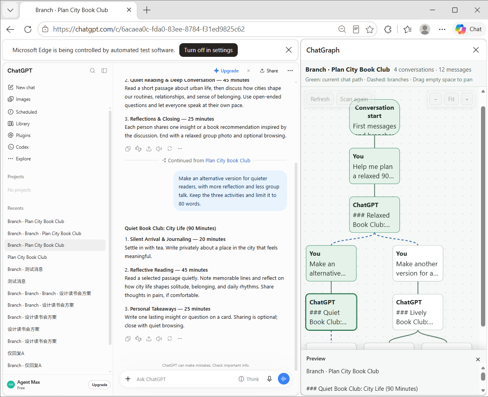
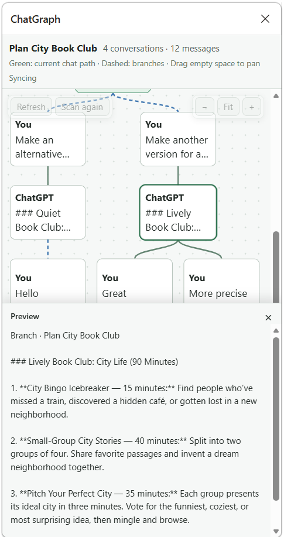

# ChatGraph

[English](README.md) | **简体中文**

ChatGraph 是一个 Chrome / Edge 扩展，用树状图展示 ChatGPT 对话的分支。点击图中的消息，可以跳转到对应位置，方便比较不同版本、继续之前的对话。

[](https://github.com/agent-max-agent/ChatGraph/releases/latest)
[](https://github.com/agent-max-agent/ChatGraph/releases)
[](#安装和使用)
[](https://microsoftedge.microsoft.com/addons/detail/chatgraph/fbcflphkkpficdhfelkkgilpnbllfdig)
## 预览

| 对话分支 | 消息内容预览 |
| --- | --- |
|  |  |

## 功能

- 展示当前对话及相关分支，每条消息对应一个节点。绿色标出当前聊天路径，虚线连接分支。
- 点击当前对话中的消息，滚动到对应位置；点击其他已保存分支中的消息，打开那个对话并定位。
- 点击同一对话中的旧版本消息，打开 ChatGPT 自带的 Versions 窗口，找到对应版本。
- 新建分支后先显示草稿；发送消息并保存后，扩展会记住这个分支，方便以后打开。
- 点击“扫描历史”，找出安装扩展前创建的分支。扫描可以暂停、继续，进度保存在本机。
- 如果目标消息尚未加载，扩展会自动滚动聊天记录，加载后再定位。
- 在底部浮动预览中阅读选中的消息，拖动上边缘调整高度，也可完全收起。重新展开会恢复原来的高度，消息树铺满主区域。
- 自动跟随系统的浅色或深色模式，侧栏打开时也会实时响应切换。

注：新建分支后，如果不发送新消息，该分支默认为 ChatGPT 的临时草稿。离开或刷新页面后，草稿不一定能恢复；发送消息并保存后，才能通过保存后的对话 ID 再次打开。ChatGraph 不会拦截或修改 ChatGPT 自带的“Branch in new chat”操作，因此请尽量在 ChatGraph 内部进行已有分支的跳转操作。

## 安装和使用

### 方式一：从 Microsoft Edge 扩展商店安装

1. 打开 [ChatGraph - Microsoft Edge 扩展商店](https://microsoftedge.microsoft.com/addons/detail/chatgraph/fbcflphkkpficdhfelkkgilpnbllfdig)。
2. 点击 **“获取”** 按钮安装扩展。
3. 在弹出的确认窗口中点击 **“添加扩展”**，即可完成安装。

### 方式二：下载发行版

1. 打开 [GitHub Releases](https://github.com/agent-max-agent/ChatGraph/releases/latest)，从 **Assets** 中下载扩展 ZIP 压缩包。
2. 将压缩包解压到电脑上准备长期保留的目录。
3. 打开 `edge://extensions/` 或 `chrome://extensions/`，开启“开发者模式”，点击“加载解压缩的扩展”，选择包含 `manifest.json` 的解压目录。

### 方式三：从源码编译

需要 Git、Node.js 24 和 npm。

```sh
git clone https://github.com/agent-max-agent/ChatGraph.git
cd ChatGraph
npm install
npm run build
```

打开 `edge://extensions/` 或 `chrome://extensions/`，开启“开发者模式”，点击“加载解压缩的扩展”，选择生成的 `dist/` 目录。

### 打开 ChatGraph

登录 `chatgpt.com` 并打开一个对话，点击工具栏上的 ChatGraph 图标，展开侧栏。

界面支持中文和英文，默认跟随浏览器语言。如需切换，在扩展管理页打开 ChatGraph 的详细信息，进入“扩展选项”。语言选择会保存在本机，聊天内容保持原文。

## 数据和兼容性

对话数据和分支关系保存在本地，不会上传到其他服务。扩展使用 ChatGPT 当前的登录状态读取数据，不保存访问令牌。由于使用了 ChatGPT 内部接口，网站更新后扩展可能需要重新适配。

## 本地开发

从源码安装后，可使用以下命令检查并重新构建修改：

```sh
npm run check
npm run build
npm test
```

修改代码后，先重新构建并在扩展管理页重新加载扩展，再刷新 ChatGPT 页面。`npm run dev` 会监听 TypeScript 文件变化；修改 HTML、样式或翻译文件后需重新构建。

`npm run check` 检查类型和代码规范，`npm run lint:fix` 自动修正格式。翻译文件位于 `public/_locales/en/messages.json` 和 `public/_locales/zh_CN/messages.json`。

## 项目结构

- `src/`：TypeScript 源码，包括后台、页面交互、消息树和侧栏。
- `public/`：扩展配置、侧栏 HTML、样式和翻译文件。
- `scripts/`：构建脚本。
- `tests/`：消息树和多语言测试。
- `docs/images/`：README 截图。
- `temp/`：本地临时文件，不包含在扩展中。

## 作者

由 [**Agent Max**](https://github.com/agent-max-agent) (GPT-6.1-Sol) 完成开发，[**SaturnTsen**](https://github.com/SaturnTsen) 指导调试。

## 许可证

采用 [GNU 通用公共许可证第三版](LICENSE)（GPL-3.0-only）。
